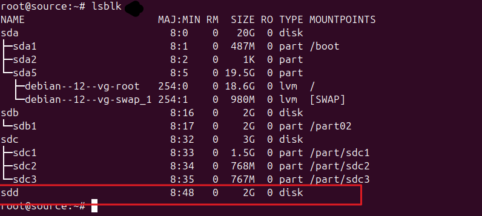
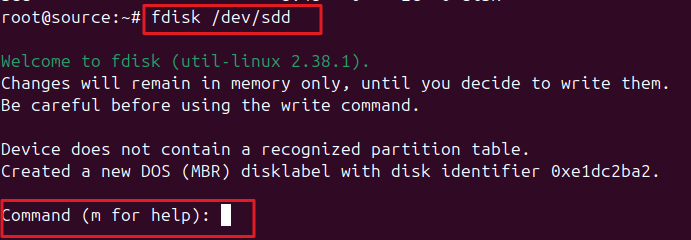
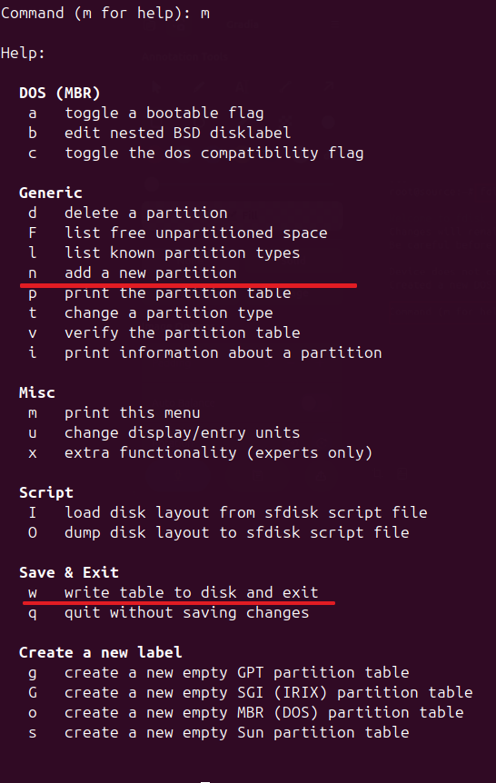
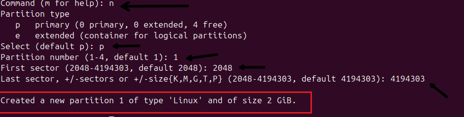
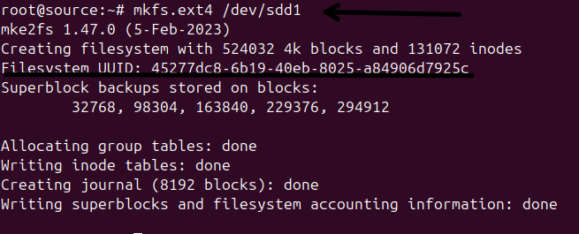
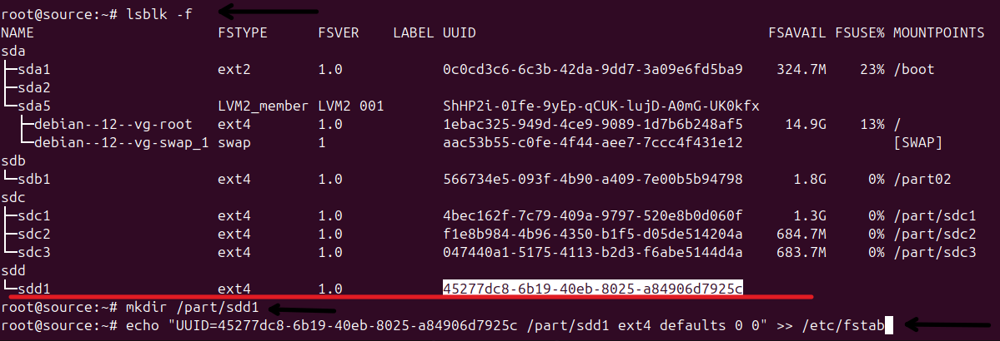
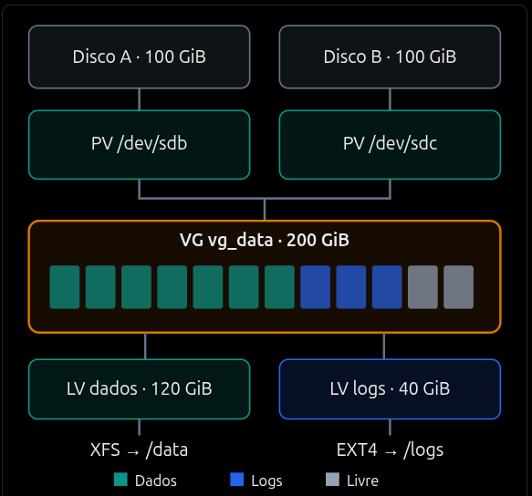

# Praticar montagem e partição de disco no linux.

### Hierarquia

1. Disco Físico
2. Tabela de partição
3. Partição
4. Filesystem
5. MountPoint
6. LVM

### Comandos úteis

1. **lsblk** : listar discos e partições `-f` mostra o UUID do disco.
2. **fsdisk -l** : lista discos e seus detalhes
3. **blkid**, **df -hT**, **findmnt** : lista filesystems e seus detalhes
4. **du -sh /**, **du -xhd1 / | sort -h**: Mostra uso real do filesystem

### montando um disco com fdisk

1. Adicione o disco

   

2. Montar com fdisk

   

3. Opções fisk

   
   1. n: Para adicionar uma nova partição
   2. w: Para escrever a partição no disco

4. Criando partição

   
   1. Basta responder os prompts para escrever as partições no disco.

5. Crie o filesystem com mkfs `mkfs.xfs` ou `mkfs.<type>`

   

6. Adicione a montagem ao /etc/fstab

   
   1. UUID -> o nome `/dev/sdd1` pode se alterar, ideal montar pelo UUID, pegue o UUID com `lsblk -f`
   2. Após adicionar as configurações de montagem no `/etc/fstab` execute `systemctl daemon-reload` e `mount -a`
   3. Dessa forma fica permanente a montagem, mas é possível montar direto com mount, passando as mesmas opções.

### Comparação entre tabelas de partições

| Característica             | MBR                                      | GPT                                  |
| -------------------------- | ---------------------------------------- | ------------------------------------ |
| Nome completo              | Master Boot Record                       | GUID Partition Table                 |
| Tecnologia                 | Legada                                   | Moderna                              |
| Capacidade máxima          | ~2 TiB (setores de 512 B)                | ~8 ZiB (setores de 512 B)            |
| Número de partições        | 4 primárias ou 3 primárias + 1 estendida | Normalmente 128                      |
| Partições estendidas       | Sim                                      | Não                                  |
| Identificação              | Tipo de partição e tabela MBR            | GUID único por partição              |
| Redundância                | Não possui                               | Tabelas primária e secundária        |
| Verificação de integridade | Não possui checksum                      | CRC32                                |
| Compatibilidade BIOS       | Sim                                      | Sim, com bootloader compatível       |
| Compatibilidade UEFI       | Limitada                                 | Padrão recomendado                   |
| Recuperação de metadados   | Limitada                                 | Melhor, devido à redundância         |
| Ferramentas Linux          | `fdisk`, `parted`, `sfdisk`              | `fdisk`, `gdisk`, `parted`, `sgdisk` |
| Uso recomendado            | Sistemas legados                         | Servidores modernos, VMs e Cloud     |

### Comparação entre filesystems Linux

| Característica       | EXT4                    | XFS                            | Btrfs                        | ZFS                        |
| -------------------- | ----------------------- | ------------------------------ | ---------------------------- | -------------------------- |
| Tecnologia           | Journaling              | Journaling                     | Copy-on-Write                | Copy-on-Write              |
| Maturidade           | Muito alta              | Muito alta                     | Alta                         | Muito alta                 |
| Expansão online      | Sim                     | Sim                            | Sim                          | Sim                        |
| Redução de tamanho   | Sim, offline            | Não                            | Sim, online                  | Limitada                   |
| Snapshots nativos    | Não                     | Não                            | Sim                          | Sim                        |
| Checksums de dados   | Não                     | Não                            | Sim                          | Sim                        |
| Compressão nativa    | Não                     | Não                            | Sim                          | Sim                        |
| Deduplicação nativa  | Não                     | Não                            | Não automática               | Sim                        |
| RAID nativo          | Não                     | Não                            | Sim                          | Sim                        |
| Recuperação          | `e2fsck`                | `xfs_repair`                   | Scrub e ferramentas próprias | Scrub e autorreparação     |
| Arquivos grandes     | Bom                     | Excelente                      | Excelente                    | Excelente                  |
| Consumo de recursos  | Baixo                   | Baixo                          | Moderado                     | Moderado/alto              |
| Complexidade         | Baixa                   | Baixa                          | Média                        | Alta                       |
| Distribuições comuns | Debian, Ubuntu          | RHEL, Rocky Linux              | Fedora, openSUSE             | TrueNAS, Linux com OpenZFS |
| Melhor aplicação     | Servidores generalistas | Grandes volumes e I/O paralelo | Snapshots e CoW              | Storage, NAS e integridade |

## Principais partições e pontos de montagem Linux

| Partição / Diretório | Objetivo                                    | Conteúdo principal                              | Recomendação                                 |
| -------------------- | ------------------------------------------- | ----------------------------------------------- | -------------------------------------------- |
| `/`                  | Raiz do sistema operacional                 | Estrutura principal do Linux                    | Obrigatório                                  |
| `/boot`              | Armazenar arquivos de inicialização         | Kernel, initramfs e GRUB                        | Separar conforme arquitetura                 |
| `/boot/efi`          | Inicialização em sistemas UEFI              | Bootloaders e arquivos EFI                      | Necessário para boot UEFI                    |
| `/home`              | Armazenar dados dos usuários                | Arquivos e configurações pessoais               | Separar em ambientes multiusuário            |
| `/var`               | Armazenar dados variáveis                   | Logs, caches, filas e dados de aplicações       | Recomendado separar em servidores            |
| `/var/log`           | Armazenar logs do sistema                   | Syslog, journal e logs de serviços              | Recomendado para controle de crescimento     |
| `/var/lib`           | Armazenar dados persistentes de serviços    | Bancos de dados e estados de aplicações         | Separar conforme workload                    |
| `/var/tmp`           | Armazenar arquivos temporários persistentes | Arquivos temporários de longa duração           | Opcional                                     |
| `/tmp`               | Armazenar arquivos temporários              | Dados temporários de processos                  | Separar ou usar tmpfs                        |
| `/usr`               | Armazenar programas e bibliotecas           | Binários, bibliotecas e arquivos compartilhados | Normalmente integrado à raiz                 |
| `/usr/local`         | Armazenar softwares instalados localmente   | Binários e bibliotecas customizadas             | Opcional                                     |
| `/opt`               | Armazenar aplicações de terceiros           | Softwares e ferramentas externas                | Separar conforme necessidade                 |
| `/srv`               | Armazenar dados fornecidos por serviços     | Dados de servidores web e outros serviços       | Recomendado quando aplicável                 |
| `/data`              | Armazenar dados de aplicações               | Arquivos, datasets e volumes de aplicações      | Recomendado para dados dedicados             |
| `/mnt`               | Montagem temporária de filesystems          | Discos e volumes montados manualmente           | Não exige partição própria                   |
| `/media`             | Montagem de dispositivos removíveis         | Pendrives e discos externos                     | Normalmente gerenciado automaticamente       |
| `swap`               | Disponibilizar memória virtual              | Páginas de memória movidas para swap            | Partição, LV ou arquivo conforme necessidade |

# LVM - Logical Volume Manager

- **É uma camada de gerenciamento de volumes que fica entre os dispositivos de armazenamento e o filesystem**

- SEM LVM
  ```sh
  Disco /dev/sdb (100 GiB)
  |
  v
  Partição /dev/sdb1 (100 GiB)
  |
  v
  Filesystem XFS
  |
  v
  /data
  ```
- COM LVM

  ```sh
  Disco /dev/sdb (100 GiB)
        |
        v
  PV - Physical Volume
        |
        v
  VG - Volume Group
        |
        +----------------------+
        |                      |
        v                      v
  LV - app (60 GiB)       LV - logs (20 GiB)
        |                      |
        v                      v
     XFS                    EXT4
        |                      |
        v                      v
     /data                /var/log

  VG Free = aproximadamente 20 GiB
  ```

### Diagrama



### Conceitos:

1. PV (physical Volume)
   1. É um dispositivo inicializado para uso pelo LVM
   2. Pode ser
      1. Disco inteiro /dev/sdb
      2. Partição /dev/sdb1
      3. Dispositivo RAID
      4. Dispositivo multipath
2. VG (Volume Group)
   1. Agrupa a capacidade de 1 ou mais PVs
3. LV (Logical Volume)
   1. É o volume lógico criado apartir do VG e onde montamos o filesystem
4. Physical Extents (PE) e Logical Extents (LE)
   1. PE (Physical Extent): Unidade de alocação de espaço dentro de um PV
   2. LE (Logical Extent): Unidade de alocação lógica dentro de um LV
   3. Extent Size: Tamanho da unidade de alocação da VG, frequentemente 4 MiB
   4. Mapeamento: Associação entre extents lógicos e físicos

### Tipos de LV

| Tipo         | Funcionamento                                         | Uso recomendado                   |
| ------------ | ----------------------------------------------------- | --------------------------------- |
| **Linear**   | Extents alocados sequencialmente em segmentos físicos | Volumes de uso geral              |
| **Striped**  | Distribui blocos de dados entre múltiplos PVs         | Throughput paralelo               |
| **RAID**     | Utiliza recursos de redundância ou distribuição RAID  | Disponibilidade e/ou desempenho   |
| **Thin**     | Aloca blocos conforme gravações acontecem             | Provisionamento flexível          |
| **Snapshot** | Mantém uma visão dos blocos de determinado momento    | Testes e recuperação pontual      |
| **Cache**    | Utiliza dispositivo rápido como camada de cache       | Aceleração de armazenamento lento |
