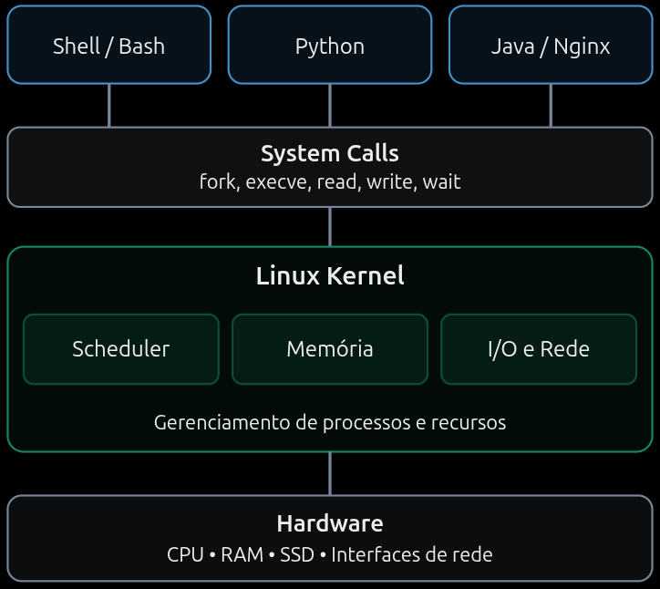
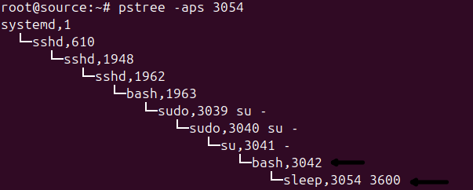
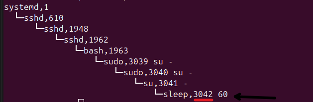
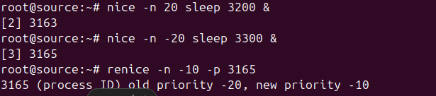

# Processos no linux

### Um processo é uma instância de um programa em execução, gerenciada pelo kernel do Linux.

Quando executa um programa, o sistema operacional cria ou reutiliza um processo para controlar a execução.

O kernel precisa gerenciar os recursos necessários para essa execução, como:

- CPU: tempo de processamento.
- Memória: espaço de endereçamento virtual, incluindo heap e stack.
- File Descriptors: arquivos, sockets e pipes abertos.
- Threads: fluxos de execução dentro de um processo.
- Permissões: UID, GID e capabilities.
- Sinais: mecanismos para controlar ou notificar processos.
- Estado: informações sobre execução, espera e encerramento.

- Diagrama
  

### Operações de criação de um processo

[Documentação fork](https://man7.org/linux/man-pages/man2/fork.2.html)

- `fork()` - Cria um processo filho



- Nesse caso o comando `sleep 3600` criou o processo `3054` filho do processo bash `3042`

- `execve` - Substitui o programa



- Nesse caso o comando `exec sleep 60` executou o sleep com o pid do bash `3042`

### Estados de um processo

[Documentação proc_pid_stat](https://man7.org/linux/man-pages/man5/proc_pid_stat.5.html)

| Estado | Significado           | Interpretação                                            |
| ------ | --------------------- | -------------------------------------------------------- |
| `R`    | Running / Runnable    | Executando ou aguardando CPU                             |
| `S`    | Interruptible Sleep   | Aguardando algum evento; pode ser despertado por sinal   |
| `D`    | Uninterruptible Sleep | Espera ininterruptível, frequentemente relacionada a I/O |
| `T`    | Stopped               | Suspenso por sinal                                       |
| `t`    | Tracing Stop          | Parado sob depuração                                     |
| `Z`    | Zombie                | Terminou, mas ainda não foi coletado pelo processo pai   |
| `I`    | Idle                  | Thread do kernel em estado ocioso                        |

### NICE

- Influência o peso relativo para consumo de CPU para tarefas normais sob concorrência.
- varia de -20 (maior prioridade relativa) até 19 (menor prioridade relativa)

- Comandos

```sh
nice -n 10 ./script.sh

renice -n 15 -p 4200
```


